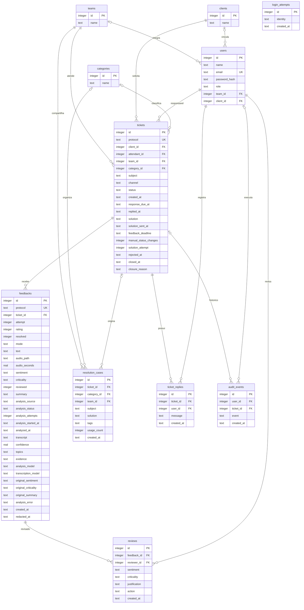

# Arquitetura e modelo de dados

## Origem das decisões

O CTI Escuta implementa o sistema de análise e acompanhamento de feedbacks descrito no repositório Desafio de Ideias. As fontes consultadas foram a [ideia geral](https://github.com/MarianaRibeiro07/desafio_de_ideias/blob/main/docs/01-ideia-geral/Ideia-geral.pdf), a [entrevista com a empresa](https://github.com/MarianaRibeiro07/desafio_de_ideias/blob/main/docs/03-entrevista/Retorno-Roteiro-Entrevista-GR2.pdf) e o [relatório](https://github.com/MarianaRibeiro07/desafio_de_ideias/blob/main/docs/05-relatorio/Relatorio-Desafio-de-Ideias.pdf).

Esses documentos não contêm um diagrama de banco ou schema existente. O modelo abaixo é novo e corresponde às tabelas de `database/schema.sqlite.sql`. As alterações de fluxo solicitadas pelo usuário prevalecem sobre a proposta inicial de feedback por link.

## Componentes

O navegador executa HTML, CSS e JavaScript e conversa com uma API PHP no mesmo domínio. A aplicação em `src/App.php` valida as entradas, aplica o escopo do usuário e usa consultas preparadas com PDO. O banco de execução local é SQLite. A imagem oficial da CTI e a fonte Inter ficam em arquivos locais de `public/assets/`.

Áudios são arquivos privados no armazenamento da aplicação; o banco guarda seus metadados e referência. A reprodução passa pela API autenticada, que verifica o atendimento ao qual o feedback pertence. O caminho físico do arquivo não é entregue no JSON.

## Diagrama de entidades

`users.team_id` é opcional para gestor e cliente; `users.client_id` é opcional para a equipe interna. A tabela `login_attempts` não possui vínculo obrigatório com usuário: registra tentativas malsucedidas, inclusive para contas inexistentes. A unicidade de feedback é composta por `ticket_id` e `attempt`, além do protocolo próprio.

## Estados e prevenção de fechamento indevido

| Estado persistido | Significado | Como entrar |
|---|---|---|
| `active` | Atendimento em andamento | Registro inicial ou negativa do cliente |
| `awaiting_feedback` | Solução enviada e aguardando confirmação | Único envio manual do atendente ou nova tentativa autorizada do supervisor |
| `resolved` | Resolução confirmada pelo cliente | Feedback com `resolved=true` |
| `closed_no_response` | Encerrado após 72 horas sem resposta | Rotina de manutenção, sem feedback da tentativa vigente |

O formulário não controla o status livremente. `manual_status_changes` admite somente 0 ou 1, e a operação de envio exige atendimento ativo e contador zero. `solution_attempt` numera as tentativas para que o feedback de uma proposta anterior não seja reutilizado como confirmação da seguinte.

A negativa do cliente limpa o prazo, registra `rejected_at` e devolve o atendimento para ativo. O supervisor da equipe pode registrar nova solução com justificativa, preservando o contador manual do atendente e o histórico, e inicia outro prazo de 72 horas. Essa atribuição do supervisor foi confirmada expressamente pelo usuário em 2026-11-05. O prazo começa no envio da solução, não na criação do atendimento.

Ao confirmar a resolução, a aplicação cria um caso de solução associado ao atendimento. Casos de demonstração são sintéticos. Sem correspondência na busca, o sistema não inventa uma resolução.

## Acesso

| Perfil | Leitura | Escrita |
|---|---|---|
| Atendente | Seus atendimentos e feedbacks, casos da equipe e relatório próprio | Registrar e editar seus atendimentos, registrar resposta e enviar uma solução |
| Supervisor | Atendimentos e feedbacks da equipe, casos e relatórios da equipe | Revisar feedback, registrar ação e nova tentativa justificada da equipe |
| Gestor | Indicadores e registros gerais, comparação entre equipes | Sem operação de atendimento ou revisão |
| Cliente | Atendimentos e feedbacks vinculados à sua organização | Avaliar e confirmar a resolução da tentativa vigente |

O vínculo do cliente usa `client_id`: usuários da mesma organização compartilham o escopo dela. A interface não é a barreira de autorização; a API verifica acesso antes de consultar ou modificar o registro. Mutações exigem token CSRF e a sessão identifica o usuário. A API limita tentativas malsucedidas de login por identidade.

## Contrato HTTP

Respostas JSON de sucesso usam `{"data": ...}`. Erros usam `{"message": "..."}`. O cliente obtém o token em `GET /api/session` e envia `X-CSRF-Token` nas mutações. A sessão usa cookie do mesmo domínio.

| Método e rota | Entrada ou finalidade |
|---|---|
| `GET /api/session` | Usuário autenticado ou `null`, além de `csrf_token` |
| `POST /api/login` | `email`, `password` |
| `POST /api/logout` | Encerra a sessão |
| `GET /api/bootstrap` | Dados do perfil, listas, atendimentos, feedbacks, casos e lembretes |
| `POST /api/tickets` | `client_id`, `subject`, `channel`, `response_due_at`, `category_id` opcional |
| `PATCH /api/tickets/{id}` | `subject`, `channel`, `response_due_at`, `category_id`; status não é aceito |
| `POST /api/tickets/{id}/solution` | `solution` com 10 a 2.000 caracteres |
| `POST /api/tickets/{id}/reply` | `message` com 5 a 2.000 caracteres |
| `POST /api/tickets/{id}/retry` | `solution`, `justification`; somente supervisor da equipe |
| `GET /api/tickets/{id}/cases` | Casos da categoria do atendimento, respeitando o escopo |
| `GET /api/cases` | `q` para texto e `category_id` opcional |
| `POST /api/feedbacks` | `ticket_id`, `rating` de 1 a 5, `resolved`, `mode`; `text` ou gravação `audio`, conforme o modo |
| `POST /api/feedbacks/{id}/review` | `sentiment`, `criticality`, `justification`, `action` |
| `POST /api/feedbacks/{id}/retry-analysis` | Reenfileira análise com falha; somente supervisor da equipe, com CSRF |
| `GET /api/feedbacks/{id}/audio` | WAV autenticado, se disponível |
| `GET /api/reports` | Indicadores filtrados |
| `GET /api/reports/export` | CSV dos atendimentos no mesmo escopo e filtros |

Os modos de feedback são `quick`, `text` e `audio`. Texto admite até 500 caracteres e cinco linhas. A gravação é WAV PCM mono de 16 bits, entre 0,1 e 60 segundos e até 6 MB; o servidor confere a estrutura do WAV. O cliente não possui opção de selecionar arquivo para upload. A transmissão da gravação utiliza o campo multipart `audio`.

O envio de feedback executa a manutenção antes de consultar o atendimento e confere novamente o prazo dentro da transação. Uma página aberta antes do vencimento não permite confirmar uma solução após as 72 horas: o servidor responde 409, preserva a ausência de avaliação e encerra o atendimento como sem retorno.

Filtros de relatório: `from`, `to`, `client_id`, `team_id`, `attendant_id`, `channel`, `q`, `sentiment`, `criticality`, `mode` e `type=criticality`. O período filtra atendimentos por data de abertura e feedbacks por data de recebimento; por isso as duas contagens não representam a mesma população. Filtros de feedback restringem também os atendimentos a registros correspondentes. O botão da interface é "Exportar atendimentos filtrados". O CSV exporta protocolo, assunto, equipe, canal, status, data e motivo de encerramento; não é uma cópia de todas as séries do dashboard nem um relatório agregado por equipe.

Erros relevantes: 401 para ausência de autenticação ou credenciais incorretas, 403 para acesso proibido, 404 para registro ou rota inexistente, 409 para conflito de etapa ou repetição, 419 para token CSRF inválido e 422 para validação. O bloqueio temporário de login responde 429.

## Automação e limites

O autocomplete usa `LIKE` em assunto, solução e tags dos casos, com categoria opcional e limite de 12 resultados. A pesquisa de casos continua textual.

Feedbacks de texto e áudio entram na fila com `analysis_status=pending`, `sentiment=pending` e `analysis_source=pending`. O envio persiste e confirma a resolução independentemente do processamento de IA. O comando `php bin/console.php analysis:work` reivindica um feedback por vez com atualização atômica, executa `ai/analyze.mjs` por `proc_open` e grava o resultado. Não há chamada a fornecedor externo nem transmissão dos feedbacks para análise. O Node lê JSON pela entrada padrão e entrega JSON pela saída padrão; a saída intermediária fica em arquivos privados temporários que são removidos ao final.

O modelo de sentimento é [twitter-XLM-RoBERTa](https://huggingface.co/cardiffnlp/twitter-xlm-roberta-base-sentiment), treinado também com português, na [conversão ONNX](https://huggingface.co/onnx-community/twitter-xlm-roberta-base-sentiment-ONNX), revisão `3112e85dea04f0019bf01282916588e3c9dd9bc8`. A transcrição usa [Whisper tiny](https://huggingface.co/Xenova/whisper-tiny), revisão `5332fcc35e32a33b86612b9a57a89be7906102b1`, com idioma português. Os dois executam na CPU com pesos quantizados em 8 bits por Transformers.js 3.8.1. Os modelos são baixados na preparação e carregados do cache local durante a análise, com `local_files_only=true`.

O áudio WAV PCM mono de 16 bits é decodificado e reamostrado para 16 kHz antes da inferência. Gravações silenciosas são recusadas pelo processador para evitar transcrição de silêncio. A transcrição preservada em `transcript` segue para o mesmo classificador usado no texto. `confidence` registra o score da classe escolhida pelo modelo, entre zero e um; ele não é uma medida calibrada da precisão em atendimentos CTI. A revisão humana permanece disponível e não é sobrescrita por resultados que chegam depois.

O resumo é extrativo, composto das primeiras frases do conteúdo. Assuntos são identificados por uma taxonomia local de palavras, e evidências são trechos originais que correspondem às regras de alerta. A criticidade combina essas regras com a negativa de resolução do cliente. Resumo, assuntos e criticidade não são apresentados como respostas de um modelo generativo. A avaliação rápida, sem texto ou áudio, usa a nota, com `analysis_source=rating` e `analysis_status=not_required`, sem simular inferência.

Os estados da fila são `pending`, `processing`, `completed`, `failed` e `not_required`. Falhas preservam texto e gravação e expõem uma mensagem segura. O supervisor da equipe pode tentar novamente. O worker limita a execução a 300 segundos por padrão, configurável até 600 por `CTI_ANALYSIS_TIMEOUT`. Jobs em processamento abandonados por 15 minutos viram falha recuperável. A contagem de tentativas impede que um resultado antigo sobrescreva uma tentativa posterior.

A API retorna transcrição, score, temas, evidências, modelos e estado apenas dentro do escopo já autorizado do usuário. Os campos `original_sentiment`, `original_criticality` e `original_summary` preservam a análise automática separada da classificação atual e do histórico de revisão. A interface consulta resultados a cada cinco segundos enquanto há jobs ativos e atualiza o conteúdo da análise sem apagar formulários em edição.

Os lembretes são calculados a partir dos registros acessíveis ao usuário. Retorno vencido, resposta nas próximas 24 horas, solicitação de confirmação e negativa de resolução aparecem no portal; não há entrega por serviço externo. A interface consulta atualizações a cada 60 segundos e ao retomar a aba, atualizando estado, contador e aviso sem reconstruir o formulário ou perder o rascunho. Sessão expirada conduz ao login e permite autenticar novamente sem recarregar a página.

## Retenção e implantação

A entrevista define 12 meses para transcrições e análises e deixa a retenção de áudio para uma política corporativa não fornecida. A decisão desta versão local é aplicar 12 meses também ao áudio, sem apresentá-la como regra da empresa. A manutenção remove arquivo de áudio, texto, transcrição, resumo, temas, evidências e conteúdo da revisão, além de mensagens antigas. Mantém os dados estruturados necessários aos indicadores e registra a remoção em `redacted_at`. O worker não reivindica conteúdo removido e descarta o resultado se a retenção ocorrer durante a inferência.

A rotina executa quando o portal consulta os dados, no envio de feedback e a cada ciclo do worker de análise. `iniciar.ps1` inicia esse worker em segundo plano junto do servidor e encerra o processo ao sair. Se o servidor for iniciado manualmente sem worker, durante períodos sem consultas o cumprimento do prazo depende do comando CLI de manutenção ou de seu agendamento no ambiente de implantação.

Isso é descarte de conteúdo, não anonimização completa de toda a base: nomes das contas, organizações, assuntos, soluções e eventos não são removidos por essa rotina. Antes de usar dados reais, é necessário definir a política de anonimização e retenção desses outros registros.

O banco SQLite é o banco utilizado pela aplicação. `database/schema.mysql.sql` descreve a modelagem equivalente para MySQL, mas não implica que o adaptador PHP esteja pronto para executar contra esse banco: há instruções e funções específicas de SQLite na implementação local. A importação do schema MySQL não foi executada nesta validação.
