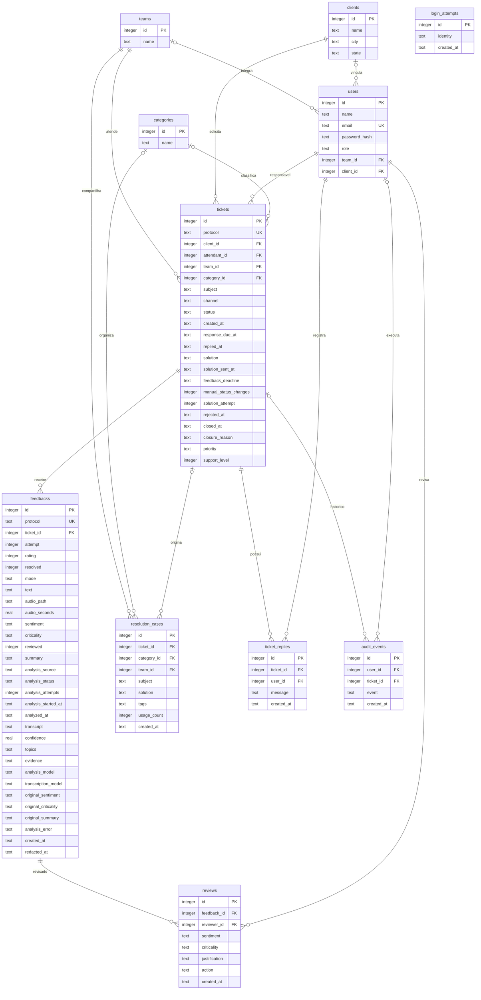

# Arquitetura e modelo de dados

## Origem das decisões

O CTI Escuta implementa o sistema de análise e acompanhamento de feedbacks descrito no repositório Desafio de Ideias. As fontes consultadas foram a [ideia geral](https://github.com/MarianaRibeiro07/desafio_de_ideias/blob/main/docs/01-ideia-geral/Ideia-geral.pdf), a [entrevista com a empresa](https://github.com/MarianaRibeiro07/desafio_de_ideias/blob/main/docs/03-entrevista/Retorno-Roteiro-Entrevista-GR2.pdf) e o [relatório](https://github.com/MarianaRibeiro07/desafio_de_ideias/blob/main/docs/05-relatorio/Relatorio-Desafio-de-Ideias.pdf).

Esses documentos não contêm um diagrama de banco ou schema existente. O modelo abaixo é novo e corresponde às tabelas de `database/schema.sqlite.sql`. As alterações de fluxo solicitadas pelo usuário prevalecem sobre a proposta inicial de feedback por link.

## Perfil da empresa

Somente fatos informados na [entrevista com a empresa](03-entrevista/Retorno-Roteiro-Entrevista-GR2.pdf), sem complemento inventado:

- Canais de feedback: tickets de suporte, e-mail, chat e chamadas telefônicas gravadas. A primeira versão prioriza tickets escritos e gravações de chamadas (Q1).
- Volume: cerca de 200 tickets e 100 chamadas gravadas por dia; as chamadas duram 6 minutos em média, e algumas passam de 20 minutos (Q3).
- Perfis: Atendente, que consulta os próprios atendimentos; Supervisor, que acompanha a equipe e trata alertas; Gestor, que vê indicadores gerais, históricos e comparações entre equipes.
- Frases e situações de criticidade: cancelamento, cobrança indevida, fraude, ameaça de processo, reclamações recorrentes e indisponibilidade do serviço; "vou cancelar", "ninguém resolveu", "já reclamei várias vezes" e "quero falar com um supervisor" (Q7). O supervisor responsável pela equipe recebe o alerta (Q14).
- Retenção: transcrições e análises por 12 meses; a retenção de áudio segue uma política corporativa que não foi informada (Q18).
- Sem vocabulário técnico específico para o sistema reconhecer (Q9) e sem exemplos anonimizados de tickets e áudios para teste (Q19). Por isso a base de demonstração é sintética e usa apenas os assuntos genéricos já presentes no seed.

## Componentes

O navegador executa HTML, CSS e JavaScript e conversa com uma API PHP no mesmo domínio. A aplicação em `src/App.php` valida as entradas, aplica o escopo do usuário e usa consultas preparadas com PDO. O banco de execução local é SQLite. A imagem oficial da CTI e a fonte Inter ficam em arquivos locais de `public/assets/`.

Áudios são arquivos privados no armazenamento da aplicação; o banco guarda seus metadados e referência. A reprodução passa pela API autenticada, que verifica o atendimento ao qual o feedback pertence. O caminho físico do arquivo não é entregue no JSON.

## Diagrama de entidades



`users.team_id` é opcional para gestor e cliente; `users.client_id` é opcional para a equipe interna. A tabela `login_attempts` não possui vínculo obrigatório com usuário: registra tentativas malsucedidas, inclusive para contas inexistentes. A unicidade de feedback é composta por `ticket_id` e `attempt`, além do protocolo próprio. `audit_events.ticket_id` é opcional: o cadastro de cliente registra o evento `client_created` sem atendimento associado.

## Estados e prevenção de fechamento indevido

| Estado persistido | Significado | Como entrar |
|---|---|---|
| `active` | Atendimento em andamento | Registro inicial (`status` ausente ou `active`) ou negativa do cliente |
| `awaiting_feedback` | Solução enviada e aguardando confirmação; é o que a tela chama de "Resolvido" | Único envio manual do atendente (depois do registro ou já no registro com `status=resolved`) ou nova tentativa autorizada do supervisor |
| `resolved` | Resolução confirmada pelo cliente | Feedback com `resolved=true` |
| `closed_no_response` | Encerrado após 72 horas sem resposta | Rotina de manutenção, sem feedback da tentativa vigente |

O formulário não controla o status livremente. `manual_status_changes` admite somente 0 ou 1, e a operação de envio exige atendimento ativo e contador zero. `solution_attempt` numera as tentativas para que o feedback de uma proposta anterior não seja reutilizado como confirmação da seguinte.

Ao registrar, o atendente pode informar `status`: `active` (padrão) ou `resolved`. Com `resolved`, `solution` (10 a 2.000 caracteres) é obrigatória e o atendimento já nasce `awaiting_feedback`, com `solution_sent_at` no momento do registro, `feedback_deadline` 72 horas depois (a mesma janela do envio de solução), `manual_status_changes=1` e `solution_attempt=1`. Isso consome a única mudança manual: `POST /api/tickets/{id}/solution` responde 409 em seguida. `resolved` no registro não encerra o atendimento; só a confirmação do cliente leva ao estado `resolved` persistido. Qualquer outro valor de `status`, ou `solution` sem `status=resolved`, é rejeitado com 422, e `PATCH /api/tickets/{id}` continua sem aceitar status.

A negativa do cliente limpa o prazo, registra `rejected_at` e devolve o atendimento para ativo. O supervisor da equipe pode registrar nova solução com justificativa, preservando o contador manual do atendente e o histórico, e inicia outro prazo de 72 horas. Essa atribuição do supervisor foi confirmada expressamente pelo usuário em 2026-11-05. O prazo começa no envio da solução, não na criação do atendimento.

Ao confirmar a resolução, a aplicação cria um caso de solução associado ao atendimento. Casos de demonstração são sintéticos. Sem correspondência na busca, o sistema não inventa uma resolução.

## Acesso

Decisão do projeto: o cliente confirma a resolução no portal.

| Perfil | Leitura | Escrita |
|---|---|---|
| Atendente | Seus atendimentos e feedbacks, casos da equipe e relatório próprio; alertas de resposta (atrasada ou prevista nas próximas 24 horas) e de cliente que informou não ter resolvido | Cadastrar clientes (empresas), registrar e editar seus atendimentos (inclusive já como resolvido), registrar resposta e enviar uma solução |
| Supervisor | Atendimentos e feedbacks da equipe, casos e relatórios da equipe; alertas de feedback crítico sem revisão e de cliente que informou não ter resolvido | Resolver as pendências da equipe: revisar críticos sem revisão e registrar ação, tentar de novo análises com falha, enviar nova tentativa justificada após a negativa do cliente |
| Gestor | Avaliar resultados da organização: indicadores, histórico, comparação entre equipes e exportação de atendimentos; nenhum alerta | Sem operação de atendimento, revisão ou tratamento de pendências |
| Cliente | Atendimentos e feedbacks vinculados à sua organização; pedidos de confirmação de resolução | Avaliar e confirmar a resolução da tentativa vigente |

A diferença entre supervisor e gestor é de função, não de volume de dados: o supervisor age sobre a fila de pendências da própria equipe, e o gestor analisa resultados de toda a organização e não recebe alertas nem em `notifications` nem em `response_overdue`. O cadastro de clientes é exclusivo do atendente; a lista de clientes não é filtrada por equipe e aparece igual para atendente, supervisor e gestor.

O vínculo do cliente usa `client_id`: usuários da mesma organização compartilham o escopo dela. A interface não é a barreira de autorização; a API verifica acesso antes de consultar ou modificar o registro. Mutações exigem token CSRF e a sessão identifica o usuário. A API limita tentativas malsucedidas de login por identidade.

## Contrato HTTP

Respostas JSON de sucesso usam `{"data": ...}`. Erros usam `{"message": "..."}`. O cliente obtém o token em `GET /api/session` e envia `X-CSRF-Token` nas mutações. A sessão usa cookie do mesmo domínio.

| Método e rota | Entrada ou finalidade |
|---|---|
| `GET /api/session` | Usuário autenticado ou `null`, além de `csrf_token` |
| `POST /api/login` | `email`, `password` |
| `POST /api/logout` | Encerra a sessão |
| `GET /api/bootstrap` | Dados do perfil, listas, atendimentos, feedbacks, casos e lembretes |
| `POST /api/clients` | `name` com 3 a 120 caracteres após remover espaços das pontas, `city` (2 a 80 caracteres) e `state` (UF válida entre as 27; minúsculas são normalizadas para maiúsculas), sem outros campos; somente atendente. Responde 201 com `{"data":{"id","name","city","state"}}`, 409 se já existir cliente com o mesmo nome (sem diferenciar maiúsculas e minúsculas), 400 se `city` ou `state` faltarem ou forem inválidos, 422 nas demais validações e 403 para os demais perfis. A unicidade tem duas camadas: a checagem em PHP (que também trata acentos e maiúsculas fora do ASCII) roda dentro de uma transação `BEGIN IMMEDIATE`, e o índice único `clients_name_nocase` (`name COLLATE NOCASE`, só ASCII) barra a corrida entre duas requisições. A violação do índice responde o mesmo 409, com rollback |
| `POST /api/tickets` | `client_id`, `subject`, `channel`, `priority` (`low`, `medium`, `high` ou `critical`, obrigatória; 400 se ausente ou inválida), `category_id` opcional; `status` opcional (`active` por padrão ou `resolved`) e `solution` (10 a 2.000 caracteres), obrigatória com `resolved` e proibida com `active`. O prazo `response_due_at` é calculado no servidor (tabela de prazos abaixo); qualquer data de prazo enviada é ignorada |
| `PATCH /api/tickets/{id}` | `subject`, `channel`, `category_id`; status não é aceito, e `response_due_at` enviado é ignorado |
| `POST /api/tickets/{id}/escalate` | `level` inteiro 2 ou 3; somente supervisor da equipe (403 para os demais perfis). O nível só aumenta: 400 se for igual ou menor que o atual ou estiver fora de 1 a 3. Grava em `audit_events` o evento `ticket_escalated_level_2` ou `ticket_escalated_level_3` e responde 200 com o atendimento |
| `POST /api/tickets/{id}/solution` | `solution` com 10 a 2.000 caracteres |
| `POST /api/tickets/{id}/reply` | `message` com 5 a 2.000 caracteres |
| `POST /api/tickets/{id}/retry` | `solution`, `justification`; somente supervisor da equipe |
| `GET /api/tickets/{id}/cases` | Casos da categoria do atendimento, respeitando o escopo |
| `GET /api/cases` | `q` para texto e `category_id` opcional |
| `POST /api/feedbacks` | `ticket_id`, `rating` de 1 a 5, `resolved`, `mode`; `text` ou gravação `audio`, conforme o modo. O texto é mascarado antes de gravar (ver Mascaramento de dados pessoais) |
| `POST /api/feedbacks/{id}/review` | `sentiment`, `criticality`, `justification`, `action` |
| `POST /api/feedbacks/{id}/retry-analysis` | Reenfileira análise com falha; somente supervisor da equipe, com CSRF |
| `GET /api/feedbacks/{id}/audio` | WAV autenticado, se disponível |
| `GET /api/reports` | Indicadores filtrados, mais `comparison`, `deadline`, `by_priority` e `by_support_level` (contrato abaixo) |
| `GET /api/reports/export` | CSV dos atendimentos no mesmo escopo e filtros |

Os modos de feedback são `quick`, `text` e `audio`. Texto admite até 500 caracteres e cinco linhas. A gravação é WAV PCM mono de 16 bits, entre 0,1 e 60 segundos e até 6 MB; o servidor confere a estrutura do WAV. O cliente não possui opção de selecionar arquivo para upload. A transmissão da gravação utiliza o campo multipart `audio`.

O envio de feedback executa a manutenção antes de consultar o atendimento e confere novamente o prazo dentro da transação. Uma página aberta antes do vencimento não permite confirmar uma solução após as 72 horas: o servidor responde 409, preserva a ausência de avaliação e encerra o atendimento como sem retorno.

Filtros de relatório: `from`, `to`, `client_id`, `team_id`, `attendant_id`, `channel`, `q`, `sentiment`, `criticality`, `mode` e `type=criticality`. O período filtra atendimentos por data de abertura e feedbacks por data de recebimento; por isso as duas contagens não representam a mesma população. Filtros de feedback restringem também os atendimentos a registros correspondentes. O botão da interface é "Exportar atendimentos filtrados". O CSV exporta protocolo, assunto, equipe, canal, status, data e motivo de encerramento; não é uma cópia de todas as séries do dashboard nem um relatório agregado por equipe.

Campos de `GET /api/reports` acrescentados nesta versão, dentro de `{"data":{...}}` e sem alterar os totais anteriores:

```json
{
  "comparison": {
    "current":  { "from": "2026-10-08", "to": "2026-11-06", "received": 12, "negative_percent": 25, "critical": 3, "negative": 3 },
    "previous": { "from": "2026-09-08", "to": "2026-10-07", "received": 9, "negative_percent": 33, "critical": 2, "negative": 3 }
  },
  "deadline": { "on_time": 20, "late": 9, "awaiting_on_time": 3, "overdue": 2, "total": 34 },
  "by_priority": { "low": 8, "medium": 12, "high": 9, "critical": 5 },
  "by_support_level": { "1": 22, "2": 8, "3": 4 }
}
```

`deadline` classifica os atendimentos do período (e do escopo do perfil) pela primeira resposta frente ao prazo `response_due_at`: `on_time` foi respondido (`replied_at`) até o prazo, `late` foi respondido depois, `awaiting_on_time` ainda não tem resposta e o prazo não venceu, `overdue` não tem resposta e o prazo venceu. `total` é a soma das quatro e iguala `total_tickets`. `by_priority` e `by_support_level` contam os mesmos atendimentos por `priority` (chaves `low`, `medium`, `high`, `critical`) e por `support_level` (chaves `"1"`, `"2"`, `"3"`), sempre com todas as chaves presentes, mesmo com zero.

`comparison` compara o período atual com o imediatamente anterior, de mesma duração em dias. A janela atual é `from` e `to` quando os dois vêm nos filtros; senão são os últimos 30 dias até hoje em UTC (29 dias atrás até hoje). A anterior termina no dia anterior ao início da atual. Datas valem pelo dia UTC de recebimento do feedback e incluem os dois extremos. Equipe, atendente, cliente, canal, sentimento, criticidade, modo, `q`, `type` e o escopo do perfil valem nas duas janelas. `received` conta feedbacks, `negative` conta os de sentimento negativo, `critical` os críticos, e `negative_percent` é o inteiro arredondado de negativos sobre analisados (sentimento positivo, neutro ou negativo), ou 0 sem analisados. Datas impossíveis (como 2026-13-45) respondem 422. A resposta de `/api/reports/export` não traz esses campos.

Prazos de resposta por prioridade, somados a `created_at` pelo servidor ao abrir o atendimento:

| Prioridade | `priority` | Prazo de resposta |
|---|---|---|
| Baixa | `low` | 8 horas |
| Média | `medium` | 4 horas |
| Alta | `high` | 1 hora |
| Crítica | `critical` | 30 minutos |

Os atendimentos anteriores a esta versão ficam com `priority` igual a `medium` e `support_level` igual a 1, sem alterar o prazo que já tinham. `support_level` vai de 1 (N1) a 3 (N3) e começa em 1. Nos JSON de atendimento a localização do cliente vem achatada, como `client_name`: os campos `client_city` e `client_state`. Em `clients` (bootstrap e cadastro) vêm `city` e `state`; clientes cadastrados antes desta versão têm os dois como `null` até serem atualizados no banco.

Erros relevantes: 401 para ausência de autenticação ou credenciais incorretas, 403 para acesso proibido, 404 para registro ou rota inexistente, 409 para conflito de etapa ou repetição, 419 para token CSRF inválido, 422 para validação geral e 400 para os campos novos de prioridade, nível de suporte, cidade e UF. O bloqueio temporário de login responde 429.

## Automação e limites

O autocomplete usa `LIKE` em assunto, solução e tags dos casos, com categoria opcional e limite de 12 resultados. A pesquisa de casos continua textual.

Feedbacks de texto e áudio entram na fila com `analysis_status=pending`, `sentiment=pending` e `analysis_source=pending`. O envio persiste e confirma a resolução independentemente do processamento de IA. O comando `php bin/console.php analysis:work` reivindica um feedback por vez com atualização atômica, executa `ai/analyze.mjs` por `proc_open` e grava o resultado. Não há chamada a fornecedor externo nem transmissão dos feedbacks para análise. O Node lê JSON pela entrada padrão e entrega JSON pela saída padrão; a saída intermediária fica em arquivos privados temporários que são removidos ao final.

O modelo de sentimento é [twitter-XLM-RoBERTa](https://huggingface.co/cardiffnlp/twitter-xlm-roberta-base-sentiment), treinado também com português, na [conversão ONNX](https://huggingface.co/onnx-community/twitter-xlm-roberta-base-sentiment-ONNX), revisão `3112e85dea04f0019bf01282916588e3c9dd9bc8`. A transcrição usa [Whisper tiny](https://huggingface.co/Xenova/whisper-tiny), revisão `5332fcc35e32a33b86612b9a57a89be7906102b1`, com idioma português. Os dois executam na CPU com pesos quantizados em 8 bits por Transformers.js 3.8.1. Os modelos são baixados na preparação e carregados do cache local durante a análise, com `local_files_only=true`.

O áudio WAV PCM mono de 16 bits é decodificado e reamostrado para 16 kHz antes da inferência. Gravações silenciosas são recusadas pelo processador para evitar transcrição de silêncio. A transcrição preservada em `transcript` segue para o mesmo classificador usado no texto. `confidence` registra o score da classe escolhida pelo modelo, entre zero e um; ele não é uma medida calibrada da precisão em atendimentos CTI. A revisão humana permanece disponível e não é sobrescrita por resultados que chegam depois.

O resumo é extrativo, composto das primeiras frases do conteúdo. Assuntos são identificados por uma taxonomia local de palavras, e evidências são trechos originais que correspondem às regras de alerta. A criticidade combina essas regras com a negativa de resolução do cliente. Resumo, assuntos e criticidade não são apresentados como respostas de um modelo generativo. A avaliação rápida, sem texto ou áudio, usa a nota, com `analysis_source=rating` e `analysis_status=not_required`, sem simular inferência.

Os estados da fila são `pending`, `processing`, `completed`, `failed` e `not_required`. Falhas preservam texto e gravação e expõem uma mensagem segura. O supervisor da equipe pode tentar novamente. O worker limita a execução a 300 segundos por padrão, configurável até 600 por `CTI_ANALYSIS_TIMEOUT`. Jobs em processamento abandonados por 15 minutos viram falha recuperável. A contagem de tentativas impede que um resultado antigo sobrescreva uma tentativa posterior.

A API retorna transcrição, score, temas, evidências, modelos e estado apenas dentro do escopo já autorizado do usuário. Os campos `original_sentiment`, `original_criticality` e `original_summary` preservam a análise automática separada da classificação atual e do histórico de revisão. A interface consulta resultados a cada cinco segundos enquanto há jobs ativos e atualiza o conteúdo da análise sem apagar formulários em edição.

Os lembretes (`notifications` em `GET /api/bootstrap`) são calculados a partir dos registros acessíveis ao usuário e dependem do perfil. Atendente: `response` (resposta atrasada ou prevista nas próximas 24 horas) e `rejected` (cliente informou que não resolveu). Supervisor: `critical` (feedback crítico sem revisão) e `rejected`, nunca `response`. Gestor: lista sempre vazia. Cliente: `feedback` (solicitação de confirmação). Em `GET /api/reports`, `response_overdue` só vem preenchido para o atendente; supervisor e gestor recebem lista vazia. Não há entrega por serviço externo. A interface consulta atualizações a cada 60 segundos e ao retomar a aba, atualizando estado, contador e aviso sem reconstruir o formulário ou perder o rascunho. Sessão expirada conduz ao login e permite autenticar novamente sem recarregar a página.

## Mascaramento de dados pessoais

Antes de gravar o texto do feedback (`POST /api/feedbacks`) e a transcrição de áudio (gravada pelo worker), a função única `App::maskSensitive` substitui por marcadores: CPF (com ou sem pontuação, 11 dígitos) por `[CPF omitido]`, telefone brasileiro (DDD com ou sem zero à esquerda, com ou sem 9, com ou sem +55, parênteses, hífen, ponto ou espaços; também celular sem DDD, que começa com 9 e tem 9 dígitos, como `98765-4321` ou `987654321`) por `[telefone omitido]` e e-mail por `[e-mail omitido]`. O worker aplica a mesma função ao resumo, aos temas e às evidências devolvidos pelo motor, que é onde um dado dito em áudio reapareceria. A análise de criticidade, o resumo e as evidências do texto usam o texto já mascarado. A função é idempotente e preserva protocolos (`ATD-2026-0001`, `FDB-2026-0001`), datas, horas, anos, valores como `R$ 1.234,56`, CEP, IPs e números curtos.

Esta é uma regra por padrão (expressão regular), não anonimização completa. Nomes próprios e endereços não são tratados. Onze dígitos soltos são sempre tratados como CPF, mesmo quando forem um celular sem pontuação. Números de 10 dígitos soltos e números de 9 dígitos iniciados em 9 são tratados como telefone. Telefone sem DDD que não comece com 9 (fixo de 8 dígitos) não é reconhecido. Um CPF digitado com pontuação parcial (por exemplo `123.456.78909`) não é reconhecido. O áudio original só é apagado pela retenção ou pelo comando `redact`; a máscara vale para o texto derivado. Dados já gravados antes desta versão não são reprocessados.

## Retenção e implantação

A entrevista define 12 meses para transcrições e análises e deixa a retenção de áudio para uma política corporativa não fornecida. A decisão desta versão local é aplicar 12 meses também ao áudio, sem apresentá-la como regra da empresa. A manutenção remove arquivo de áudio, texto, transcrição, resumo, temas, evidências e conteúdo da revisão, além de mensagens antigas. Mantém os dados estruturados necessários aos indicadores e registra a remoção em `redacted_at`. O worker não reivindica conteúdo removido e descarta o resultado se a retenção ocorrer durante a inferência.

A rotina executa quando o portal consulta os dados, no envio de feedback e a cada ciclo do worker de análise. `iniciar.ps1` inicia esse worker em segundo plano junto do servidor e encerra o processo ao sair. Se o servidor for iniciado manualmente sem worker, durante períodos sem consultas o cumprimento do prazo depende do comando CLI de manutenção ou de seu agendamento no ambiente de implantação.

Exclusão sob demanda: `php bin/console.php redact --feedback=ID` aplica ao feedback indicado a mesma remoção de conteúdo da retenção (função interna compartilhada com a manutenção), sem esperar os 12 meses. Remove texto, transcrição, resumo, temas, evidências, referência e arquivo de áudio e o texto das revisões; preserva nota, sentimento, criticidade, modo e demais dados estruturados; define `redacted_at`; e registra o evento de auditoria `content_redacted` ligado ao atendimento do feedback, sem usuário (execução por linha de comando). Imprime JSON com `feedback_id`, `protocol`, `status` (`redacted` ou `already_redacted`), `redacted_at` e `audio_removed`. `audio_removed` só é `true` quando o arquivo existia e foi apagado de fato; se o arquivo não existe, ou se o `unlink` falha, vale `false` e a falha é registrada no log de erros do PHP com o nome do arquivo, sem o caminho completo. Repetir o comando não falha nem duplica a auditoria. ID inexistente, ausente ou não numérico sai com código 1 e mensagem em stderr.

Isso é descarte de conteúdo, não anonimização completa de toda a base: nomes das contas, organizações, assuntos, soluções e eventos não são removidos por essa rotina. Antes de usar dados reais, é necessário definir a política de anonimização e retenção desses outros registros.

Para a evolução com volume (paginação, agregação no banco, MySQL), veja [escalabilidade](escalabilidade.md).

O banco SQLite é o banco utilizado pela aplicação. `database/schema.mysql.sql` descreve a modelagem equivalente para MySQL, mas não implica que o adaptador PHP esteja pronto para executar contra esse banco: há instruções e funções específicas de SQLite na implementação local. A importação do schema MySQL não foi executada nesta validação.
